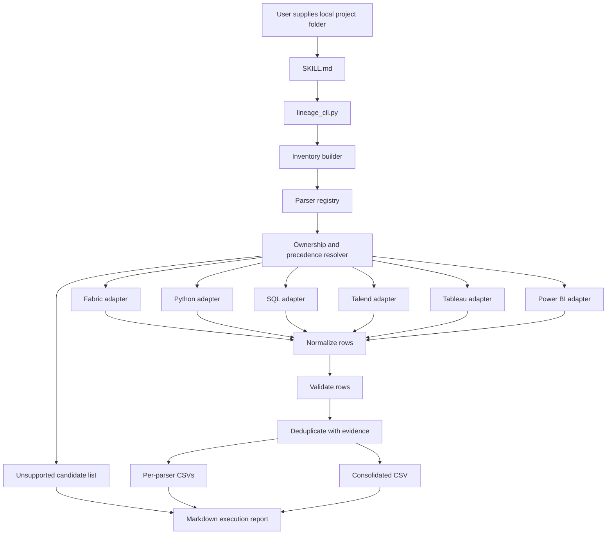

# Multi-Platform Lineage Execution Flow

## Entry Points

### Fabric-only entry point

The current custom agent invokes `tools/parsers/parse_fabric_lineage.py` directly. Only the Fabric repository workflow is integrated.

### Multi-platform entry point

The primary user entry point is:

```text
.github/skills/generate-lineage/SKILL.md
```

The deterministic code entry point called by the skill is:

```powershell
python tools/lineage_cli.py generate "<input-folder>"
```

The same command can be executed directly without the chat or skill layer.

## Component Flow



## Order of Execution

### 1. Skill invocation

The skill obtains one local folder path and invokes the CLI exactly once. It does not inspect files, select parsers, or generate lineage rows itself.

```text
generate-lineage <input-folder>
```

### 2. CLI argument validation

`lineage_cli.main()` parses arguments and calls `run_generate()`.

```text
main()
└── parse_arguments()
└── run_generate(input_folder, output_folder, options)
```

`run_generate()` confirms that the input is a directory and creates a run context. Source artifacts remain read-only.

### 3. Inventory construction

`build_inventory()` walks the repository once.

```text
build_inventory(root)
├── walk_repository(root)
├── apply_exclusions(path)
├── inspect_file_signature(path)
├── classify_candidate(path, signature)
└── return Inventory
```

Default exclusions include generated output, Git metadata, virtual environments, dependency folders, and caches.

The inventory records candidate paths and evidence, not lineage rows.

### 4. Parser selection

`select_parsers()` evaluates the inventory against the static registry.

```text
select_parsers(inventory, registry)
├── find_registry_matches(candidate)
├── resolve_precedence(matches)
├── assign_file_to_parser(candidate, winner)
└── record_unsupported_candidate(candidate)
```

The most-specific parser wins. For example:

```text
Fabric notebook-content.py → Fabric parser
ordinary transform.py      → Python parser
standalone view.sql        → SQL parser
```

### 5. Parser execution

`execute_parsers()` runs every selected parser independently.

```text
execute_parsers(assignments, context)
└── for parser assignment
    ├── adapter.parse(context, assigned_files)
    ├── capture emitted rows
    ├── capture warnings and statistics
    └── capture failure without stopping independent parsers
```

The adapter boundary gives existing scripts a common interface:

```python
def parse(context, files):
    """Return lineage rows and parser statistics without writing final output."""
```

### 6. Existing parser call paths

The adapters call the existing parser logic as follows.

```text
Fabric adapter
└── discover_repository()
└── activate_repository()
└── parse_notebooks()
└── parse_pipelines()
└── load_shortcuts() / shortcut_rows()
└── parse_semantic_models()
└── parse_reports()
└── parse supported ingestion configurations

Python adapter
└── scan only assigned .py and .ipynb files
└── call existing per-file Python extraction logic

SQL adapter
└── scan only assigned SQL/DDL files
└── call existing SQL statement extraction logic

Talend adapter
└── route supported .item files and inventory inputs
└── call the appropriate existing Talend extraction logic

Tableau adapter
└── validate the required Tableau metadata input signature
└── call existing strict Tableau extraction logic

Power BI adapter
└── parse supported PBIP/TMDL/PBIR artifacts
└── normalize supported pre-generated Power BI lineage inputs
```

The Python, SQL, Talend, Tableau, and standalone Power BI scripts expose in-memory entry points used by the shared adapters; their legacy standalone entry points remain available.

### 7. Row normalization

Each adapter's output passes through `normalize_rows()` before validation.

```text
normalize_rows(parser_result)
├── apply canonical column order
├── normalize null and boolean values
├── normalize platform and type tokens
├── preserve transform evidence
└── preserve ambiguity flags
```

Canonical direction is:

```text
Source_* (upstream) → Target_* (downstream)
```

### 8. Validation

`validate_rows()` separates valid and rejected rows.

```text
validate_rows(rows)
├── validate 18-column shape
├── validate required objects
├── validate direction invariants
├── validate known enumerations
├── validate transform evidence
└── return valid_rows, rejected_rows, diagnostics
```

A parser can finish successfully while individual invalid rows are rejected. Rejections are counted in the report.

### 9. Deduplication

`deduplicate_rows()` removes exact duplicate evidence while retaining parallel transformations.

The identity includes:

```text
source identity
target identity
dependency type
transform tool
transform name
transform path
column evidence
```

### 10. Output writing

`write_outputs()` writes successful parser outputs and the merged result.

```text
write_outputs(run_result)
├── write_parser_csv(parser_id, valid_rows)
├── write_consolidated_csv(all_valid_rows)
└── write_execution_report(run_result)
```

The Markdown execution report includes:

- Input and output paths.
- Inventory counts.
- Parsers selected and files assigned.
- Parser status and row counts.
- Unsupported candidates.
- Warnings and parser failures.
- Rejected-row counts and reasons.
- Final run status.

### 11. Final status

`determine_run_status()` returns:

```text
SUCCESS  all selected parsers completed and no unsupported candidates exist
PARTIAL  some valid lineage exists, with parser failures or unsupported candidates
FAILED   no valid lineage can be published
```

The skill reports this status and the consolidated CSV path to the user.

## Example Execution

Input repository:

```text
CustomerAnalytics/
├── Fabric/Gold/Notebooks/.../notebook-content.py
├── scripts/load_customers.py
├── sql/customer_summary.sql
├── talend/LoadCustomers.item
└── unsupported/pipeline.json
```

Execution:

```text
SKILL.md
→ lineage_cli.py
→ inventory: Fabric + Python + SQL + Talend + unsupported JSON
→ ownership resolver assigns each supported file once
→ four deterministic parsers execute
→ rows normalize and validate
→ evidence-aware deduplication
→ per-parser CSVs
→ lineage_metadata_consolidated.csv
→ lineage_execution_report.md with unsupported pipeline.json warning
→ final status: PARTIAL
```

No LLM or SLM call occurs after the skill invokes the CLI. Unknown formats are reported, not parsed speculatively.