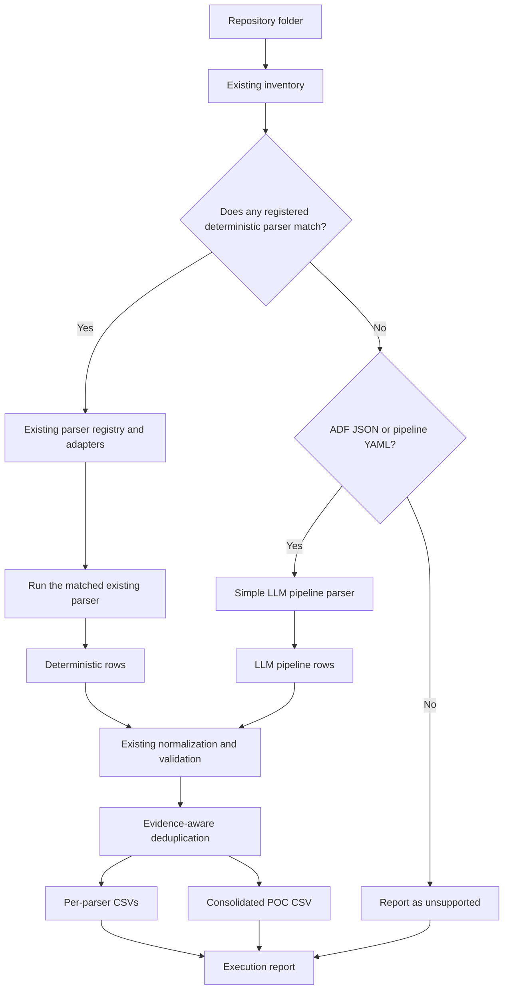

# Hybrid Deterministic and LLM Lineage POC

## How to Run
For simple deterministic run, where call to LLM is not required:
```powershell
python tools\lineage_cli.py generate "<input-folder-path>"
```

Use the optional flag to infer the LLM. Invoking the LLM requires env configuration (refer env-example file). The default env configuration triggers Copilot CLI with auto-selection of model:

```powershell
python tools\lineage_cli.py generate "<input-folder-path>" --llm-poc
```

Without `--llm-poc`, the current deterministic behaviour remains exactly the same.

## Goal

Run a short proof of concept in which one repository can contain both supported artifacts and unsupported pipeline definitions.

Known artifacts continue through the existing deterministic parsers. Only static ADF pipeline JSON and pipeline-style YAML files that have no deterministic owner are sent to a simple LLM pipeline parser.

The POC reuses the existing inventory, parser registry, 18-column schema, validation, deduplication, CSV output, and Lineage Viewer.

## Simple Architecture



The decision block evaluates every candidate against the complete existing `PARSER_REGISTRY`, currently containing Fabric, Talend, Tableau, Power BI, SQL/Redshift, and Python. It is not limited to the three example technologies in the input repository.

The block uses the existing `select_parsers()` result:

- Assigned candidates follow their deterministic parser.
- Unsupported candidates are checked against the small LLM pipeline allowlist.
- Files with at least one accepted LLM row and no rejected rows are listed under
  **LLM Fallback Coverage** as **Not covered by default parsers, used LLM**, rather
  than under Unsupported Candidates.
- All remaining candidates stay unsupported.

The inventory retains original detection signatures; these describe routing
before LLM fallback, not final coverage. Empty responses, model errors, skipped
files, and files with rejected rows remain unsupported/unresolved. A file with
both accepted and rejected rows retains its accepted CSV rows but is not marked
fully covered. Diagnostics are never suppressed. A run can be `SUCCESS` when
LLM fallback covers all otherwise unsupported files and all parsers succeed;
remaining uncovered files or parser errors keep a run with valid output `PARTIAL`.
No valid output still means `FAILED`. Accepted rows indicate schema validation,
not a guarantee that model-inferred lineage is semantically complete.

The deterministic flow remains unchanged unless the user explicitly enables the POC. A Fabric `.DataPipeline` remains Fabric-owned and is never sent to the LLM.

## Example Routing

| Repository artifact | Route |
|---|---|
| Fabric semantic model | Deterministic Fabric parser |
| Fabric Lakehouse metadata | Deterministic Fabric parser |
| Fabric DataPipeline | Deterministic Fabric parser |
| Python notebook | Deterministic Python parser |
| SQL script | Deterministic SQL parser |
| Redshift view inventory | Deterministic SQL/Redshift parser |
| Talend `.item` or inventory | Deterministic Talend parser |
| Tableau metadata CSV | Deterministic Tableau parser |
| Supported Power BI lineage CSV | Deterministic Power BI parser |
| Static ADF Copy pipeline JSON | Simple LLM pipeline parser |
| Pipeline or workflow YAML | Simple LLM pipeline parser |
| Binary or unrelated unsupported file | Report as unsupported |

## POC Scope

Include only:

- Static ADF pipeline JSON already classified as `unsupported-pipeline-definition`.
- YAML files already classified as `unsupported-pipeline-definition` because their name or content resembles a pipeline or workflow.
- Files no larger than a small configured limit, such as 100 KB.
- One explicitly selected backend per run: an OpenAI-compatible HTTP endpoint or GitHub Copilot SDK.
- Static source-to-sink table or file lineage from pipeline activities.

Do not include:

- Binary files such as PBIX or TWBX.
- Large-file chunking.
- Live Fabric, database, or SaaS connections.
- Automatic parser generation.
- Automatic cross-provider fallback.
- Caching, confidence scoring, or a review application.
- Column-level lineage.
- General-purpose parsing of arbitrary unsupported files.
- LLM parsing of artifacts already owned by a deterministic parser.
- Pipeline scheduling, triggers, variables, or orchestration lineage.

## Processing Flow

1. Build the existing repository inventory once.
2. Run `select_parsers()` using the existing static parser registry.
3. Send every assigned candidate to its matched existing deterministic adapter: Fabric, Talend, Tableau, Power BI, SQL/Redshift, or Python.
4. Inspect only `selection.unsupported` for the LLM route.
5. Select only `.json`, `.yaml`, or `.yml` candidates with the `unsupported-pipeline-definition` signature and within the size limit.
6. Read and send one eligible pipeline file at a time to the simple LLM parser.
7. Require the model to return JSON only.
8. Convert returned JSON objects into canonical rows.
9. Force every LLM POC row to use:
  - `Transform_Tool = LLM_PIPELINE_POC`
   - `Is_Ambiguous = Yes`
   - `Transform_Path = <unsupported file path>`
10. Pass deterministic and LLM rows through the existing normalization and validation functions.
11. Reject invalid LLM rows without retrying.
12. Write valid LLM rows to `lineage_metadata_llm_pipeline_poc.csv`.
13. Combine valid deterministic and LLM rows in `lineage_metadata_consolidated_poc.csv` for demonstration in the viewer.

The normal `lineage_metadata_consolidated.csv` should remain deterministic during the POC.

## Model Configuration

The LLM POC remains opt-in through `--llm-poc`. Choose one backend explicitly;
there is no automatic fallback between providers.

### Existing HTTP backend (default)

Use these environment variables:

```text
LINEAGE_LLM_ENDPOINT
LINEAGE_LLM_API_KEY
LINEAGE_LLM_MODEL
```

The endpoint should support an OpenAI-compatible chat-completions request. The API key must not be stored in the repository.

`LINEAGE_LLM_PROVIDER=http` selects this backend. Omitting the provider preserves
the original HTTP behavior and does not require the Copilot SDK.

### GitHub Copilot SDK backend (Claude Sonnet or another available model)

Requires Python 3.11+, a GitHub account with Copilot access, and permission to use
the selected model under your organization's policies. Models run remotely;
this is not local/offline inference. Requests count toward your Copilot allowance.

1. Install the pinned optional dependency and prepare its runtime:

   ```powershell
   python -m pip install -r requirements-copilot.txt
   python -m copilot download-runtime
   ```

2. Install the [GitHub Copilot CLI](https://docs.github.com/en/copilot/how-tos/set-up/install-copilot-cli)
   if it is not already available. Start `copilot` and sign in with `/login`.
   The SDK runtime is bundled, but its headless executable is not the interactive
   CLI. VS Code sign-in alone does not guarantee SDK authentication. The SDK uses
   its supported GitHub authentication, not `LINEAGE_LLM_API_KEY`.

3. Use `/model` in the Copilot CLI to find a Claude Sonnet model available to
   your account. Set the following in the project `.env`, substituting its exact
   model ID:

   ```dotenv
   LINEAGE_LLM_PROVIDER=copilot
   LINEAGE_COPILOT_MODEL=<exact-model-id-from-your-account>
   LINEAGE_LLM_TIMEOUT=300
   ```

   HTTP endpoint/key settings can remain in `.env`; the Copilot backend ignores
   them. It also ignores `LINEAGE_LLM_MODEL` to avoid accidentally requesting your
   Qwen model through Copilot. Existing terminal environment variables take
   precedence over `.env`. If calling `run_generate()` directly, load or set the
   environment yourself; automatic `.env` loading is provided by the CLI.

4. Generate lineage as before:

   ```powershell
   python tools\lineage_cli.py generate "<input-folder>" --llm-poc
   ```

Only eligible unsupported pipeline files are submitted. Deterministic parser
ownership, prompts, response JSON decoding, validation, forced POC provenance,
and CSV output names are unchanged. Each file uses a separate SDK session with a
temporary working directory and no available tools, MCP servers, repository config
discovery, inherited agent instructions, skills, hooks, or persistent memory.
The normal Copilot credential/config directory is preserved so saved CLI login
can be used. Do not set `mode="empty"` or redirect `base_directory` to a fresh
temporary directory when relying on saved CLI credentials: empty mode disables
system-keychain authentication, and `base_directory` changes `COPILOT_HOME`.
The configured model must appear in
the account's available model list; it is never silently replaced by another model.
The session created by the request is deleted during cleanup, then the runtime
is stopped and the temporary working directory is removed. Existing sessions and
saved CLI authentication are not deleted.

`LINEAGE_LLM_TIMEOUT` must be a finite positive number of seconds (default 60).
For Copilot it bounds startup, authentication, model discovery, and response
waiting; cleanup may take up to an additional 10 seconds before a forced stop.
Missing SDK, authentication, model availability, timeout, and session errors are
reported through the existing execution diagnostics, not treated as empty lineage.
The CLI is synchronous; async callers should use `asyncio.to_thread`.

To switch back, set `LINEAGE_LLM_PROVIDER=http` and retain the original HTTP
endpoint, API key, and model settings.

## Prompt

Both backends use the same system instructions and generated user prompt. The user
prompt includes all canonical row columns and the exact enum values imported from
the validator, so the model does not have to infer the output contract:

| Column | Allowed values |
|---|---|
| `Dependency_Type` | `DATA_FLOW`, `ORCHESTRATION`, `SHORTCUT` |
| `Location_Type` | `LOCAL`, `EXTERNAL`, `REMOTE` |
| `Schema_Bound`, `Is_Ambiguous` | `Yes`, `No` |

Copy activities use `Dependency_Type=DATA_FLOW`. A remote SQL Server/Azure Blob
relationship uses `Location_Type=REMOTE`; `COPY` and `AZURE BLOB STORAGE` are
not valid values for these two columns. Technology labels belong in the platform
columns. The prompt also specifies required fields, string values, unknown optional
fields as `"NULL"`, and forced POC provenance. Both providers retain the same
strict validation; invalid values are not silently coerced or retried.

The core extraction instructions are:

```text
You extract source-to-sink data lineage from a static ADF JSON or YAML pipeline definition.

Rules:
- Source is the upstream object being read.
- Target is the downstream object being written.
- Extract only Copy, move, or equivalent data-transfer activities.
- Ignore triggers, schedules, variables, conditions, and control activities.
- Return only source-to-sink relationships explicitly supported by the file.
- Do not invent schemas, tables, files, platforms, or columns.
- Preserve dynamic expressions exactly as written.
- Return an empty rows array when lineage cannot be established.
- Return JSON only using the supplied schema.

File path: <relative path>
File content:
<content>
```

Expected response:

```json
{
  "rows": [
    {
      "Source_Schema": "dbo",
      "Source_Object": "Customers",
      "Source_Type": "TABLE",
      "Target_Schema": "sales",
      "Target_Object": "Customers",
      "Target_Type": "TABLE",
      "Dependency_Type": "DATA_FLOW",
      "Column_Or_Parameter": "*",
      "Schema_Bound": "No",
      "External_Location": "NULL",
      "Is_Ambiguous": "Yes",
      "Location_Type": "REMOTE",
      "Source_Platform": "AZURE",
      "Target_Platform": "FABRIC_LAKEHOUSE",
      "Transform_Tool": "LLM_PIPELINE_POC",
      "Transform_Name": "Copy Customers",
      "Transform_Path": "pipelines/load_customers.json",
      "Source_Column": "NULL"
    }
  ]
}
```

## Minimal Code Changes

### New file

`tools/llm_pipeline_poc_parser.py`

Responsibilities:

- Validate environment variables.
- Accept only eligible ADF JSON and pipeline YAML candidates from the decision block.
- Build the prompt.
- Call the configured endpoint.
- Parse JSON responses.
- Return canonical row dictionaries and warnings.

Use the Python standard library HTTP client to avoid adding a package for the POC.

### Existing files

| File | Small change |
|---|---|
| `tools/lineage_cli.py` | Add `--llm-poc`; route unsupported pipeline candidates to the LLM after deterministic ownership is resolved, then validate and write the POC CSVs. |
| `tools/reporting.py` | Add a short POC summary: eligible files, requests, valid rows, rejected rows, and errors. |
| `.github/skills/generate-lineage/SKILL.md` | Pass `--llm-poc` only when the user explicitly requests it. |

No changes are required to the existing deterministic parser registry.

## Error Handling

- Missing configuration: stop the POC stage and retain deterministic outputs.
- Endpoint timeout or failure: record a warning and continue with the next candidate.
- Invalid JSON: reject that response and continue.
- Invalid lineage row: let the existing validator reject it.
- No extracted rows: record the file as unresolved.
- Never send the API key in logs or reports.

The deterministic run must never fail because the optional POC stage failed.

## POC Tests

Use mocked HTTP responses; CI must not call a live model.

Implement five focused tests:

1. The default command makes no model call.
2. A mixed repository routes Fabric, Python, and SQL to deterministic parsers while routing only ADF JSON and pipeline YAML to the LLM.
3. Invalid model JSON produces no LLM rows and preserves deterministic output.
4. A row missing an endpoint is rejected by the existing validator.
5. Oversized and binary files are not sent to the model.
6. A Fabric DataPipeline is never sent to the LLM.

## Success Criteria

The POC is successful when:

- Existing deterministic tests still pass unchanged.
- `--llm-poc` sends only eligible ADF JSON and pipeline YAML files.
- Fabric artifacts, Python notebooks, and SQL scripts still use deterministic parsers.
- At least one ADF Copy pipeline and one YAML pipeline produce correct upstream-to-downstream lineage.
- Invalid or unavailable model output does not affect deterministic results.
- Valid model rows appear in `lineage_metadata_llm_pipeline_poc.csv`.
- `lineage_metadata_consolidated_poc.csv` loads successfully in the existing viewer.
- The implementation remains small enough to remove or replace after the POC.

## Suggested Implementation Order

1. Add a routing test for the mixed example repository.
2. Create `llm_pipeline_poc_parser.py` with mocked ADF and YAML responses.
3. Add `--llm-poc` to the CLI after deterministic parser selection.
4. Reuse existing normalization and validation.
5. Write the POC CSV outputs and minimal report fields.
6. Test with one real static ADF Copy pipeline and one pipeline YAML file.

## One Decision Needed

Choose the OpenAI-compatible endpoint and model to use for the live POC. Everything else can use the defaults in this document.